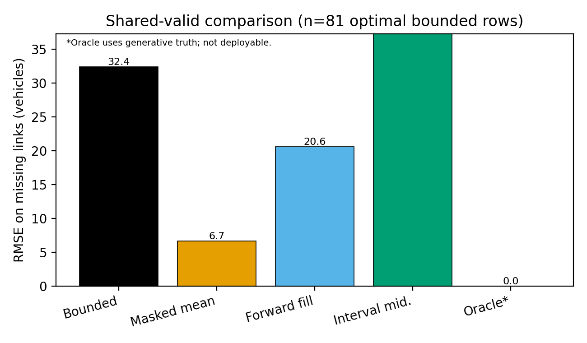
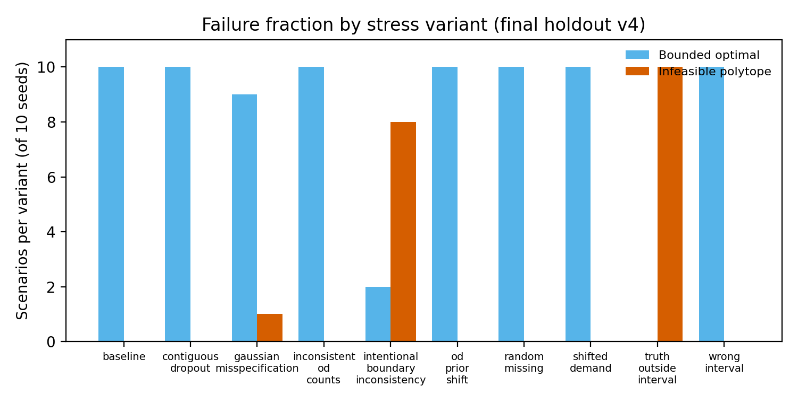

# Bounded Conservation with Partial Identification on Synthetic Chain Networks: A Preregistered-Style Holdout with Negative Point-Estimate Accuracy

**Status:** Workshop / negative-findings methodological report (not conference-ready SOTA).  
**Inference frozen at:** `c15d37e54fe38d63` | **Corrected analysis script:** `8ac2ca5f2b8136d8…` (full hash in `results/research_final_v4/analysis_receipt.json`).  
**Author verification required** — see `AUTHOR_VERIFICATION_REQUIRED.md`.

## Abstract

We report a transparent synthetic benchmark for discrete conservation-based traffic state estimation under missing mainline counts and interval bounds on boundary demand. A deployable estimator fits boundary flows inside a hard conservation polytope with linear-inequality observations; partial-identification machinery supplies LP extrema on path-flow aggregates. On an amended final holdout (100 scenarios: 10 stress variants × 10 seeds), the deployable bounded point estimate achieves mean missing-link state RMSE **32.41** vehicles on the **81** scenarios with optimal bounded solutions—worse than masked-mean (**6.66**) and forward-fill (**20.60**) imputers on the same subset. **19** scenarios yield infeasible polytopes by design (10 + 8 + 1 breakdown). We do not claim algorithmic novelty or superiority to modern GNN or physics-informed pipelines omitted from the matrix. Post-hoc cluster-bootstrap uncertainty and denominator reconciliation were applied after execution (documented erratum); they were not part of the frozen inference hash.

**Keywords:** traffic state estimation; conservation laws; partial identification; missing data; OD feasibility; reproducibility

## 1. Introduction

Traffic agencies reconcile loop-detector counts with conservation when sensors fail or drift (Cáceres et al., 2019). OD synthesis from partial link volumes has a long linear-programming lineage (Sherali et al., 1994; Sherali et al., 2003), alongside entropy and least-squares variants (Xie et al., 2011). Learning-based methods now target missing spatio-temporal fields (Pu et al., 2020; Shi et al., 2021). Econometric partial-identification theory clarifies when models identify sets rather than points (Molinari, 2020; Galichon and Henry, 2011).

This document is **not** a new estimator paper. It packages an existing research stack with explicit negatives: on holdout v4, hard conservation with partial ID does **not** beat masked mean on missing-link RMSE.

## 2. Setup and notation

- **Storage** \(N \in \mathbb{R}^{L\times T}\) (vehicles), step \(\Delta t\) (hours).
- **Boundary** \(u \in \mathbb{R}^{2\times T}\) on inlet/outlet columns of \(R\); interior path flows \(z\) via \(B\).
- **Discrete balance:** \(N_{:,t+1} = N_{:,t} + \Delta t (B z_{:,t} + R u_{:,t})\).
- **Observations:** interval counts on masked mainline cells; Boolean `count_observed_mask`.
- **Partial ID:** nonnegative path flows \(f\), incidence \(A\), constraints \(l \le Af \le u\); HiGHS `linprog` extrema (`src/research/partial_identification.py`).

Full module narrative: `docs/research_formulation.md`. Simulator domain: `docs/research_simulator_domain.md` (discrete queue with rejected boundary demand; not full CTM/LWR).

## 3. Estimators and baselines

| Method | Role |
|--------|------|
| Bounded boundary LP fit | Deployable; hard obs constraints, \(w_{\mathrm{obs}}=0\) |
| Masked mean / forward fill | Unconstrained imputers |
| Interval midpoint on \(u\) | Wide honest baseline |
| Oracle exact boundary | Diagnostic only (uses generative truth) |
| OD NNLS | **Withdrawn** from comparisons (frozen mask bug; erratum) |

LP interval tightening is reported only as empirical coverage on stated boxes; feasibility does not imply truth lies in the polytope.

## 4. Protocol transparency (concise)

| Generation | Status |
|------------|--------|
| v1 seeds 101–505 | Retired (exposure) |
| v2 seeds 701–1105 | Retired (subset executed) |
| v3 | Single failed final attempt; not rerun |
| v4 | Amended reserve; **one** completed run → `results/research_final_v4/` |

Analysis post-hoc correction: `docs/research_analysis_erratum.md`. Historical `results/research/build_verification.json` retains analysis script prefix `e00d4da51c0b965e`; manuscript numerics use corrected outputs linked by `research_manuscript/packaging_analysis_receipt.json`.

`wrong_interval` stress: truth remains inside the stated boundary box (narrower truth-containing interval).

## 5. Results (from `final_analysis.json`)

### 5.1 Matrix outcomes

| Quantity | Value |
|----------|------:|
| Scenarios | 100 |
| Bounded optimal | 81 |
| Infeasible polytope | 19 |
| Infeasible: `truth_outside_interval` | 10 |
| Infeasible: `intentional_boundary_inconsistency` | 8 |
| Infeasible: `gaussian_misspecification` | 1 |
| Rows with generative boundary truth in stated box | 80 |
| Boundary interval covers truth (net vehicles), matrix | **80/100** |
| LP data covers truth on bounded-valid rows | **79/81** |

### 5.2 Primary metric (shared valid, n=81)

| Method | Mean missing RMSE (veh) |
|--------|----------------------:|
| Bounded deployable | 32.4108 |
| Masked mean | 6.6591 |
| Forward fill | 20.6045 |
| Interval midpoint | 66.1359 |
| Oracle (diagnostic) | 0.0 |

Paired bounded − masked mean: **25.7517** (bootstrap mean of replicate paired means **25.7230**, 95% CI **[21.166, 31.333]**).

Bootstrap on bounded primary (post-hoc): mean **32.3760**, 95% CI **[27.851, 37.883]** (`resampling_seed=424242`, 10 clusters, 10 000 replicates).

Full-matrix masked-mean mean (n=100 finite): **6.6636** — distinct denominator from shared-valid column.

### 5.3 RMSE slices (shared valid)

| Method | Missing | Observed | All |
|--------|--------:|---------:|----:|
| Bounded | 32.41 | 10.46 | 17.75 |
| Masked mean | 6.66 | 7.45 | 7.41 |
| Forward fill | 20.60 | 7.45 | 11.93 |

### 5.4 Figures

LaTeX tables: regenerate via `python research_manuscript/scripts/generate_manuscript_tables.py`.

## 6. Illustrative non-identifiability

With one wide aggregate bound on nonnegative path flows, multiple path splits remain feasible; LP intervals for totals have positive width. **Illustrative only** — not claimed as a new theorem.

## 7. Discussion

Conservation-structured feasibility does not, on this holdout, yield better missing-link point accuracy than masked mean. Strong learned baselines are absent by design. v4 is an amended protocol after generative repair, not a blind repeat of original v3 preregistration.

## 8. Limitations

Synthetic chains; single final matrix; ten seed-level bootstrap clusters; measured NGSIM adapter is development-only; no OD ground truth on measured slice; OD NNLS comparison invalid in frozen runner.

## 9. Declarations

Placeholder front matter in `AUTHOR_VERIFICATION_REQUIRED.md`. AI usage documented there.

## 10. Availability

- Frozen rows: `results/research_final_v4/pilot_results.json` (SHA witness in `analysis_receipt.json`).
- Verification: `python research_manuscript/scripts/verify_immutable_inputs.py`.
- Do not modify frozen inference artifacts when regenerating tables.

## References

See `references.bib` and `CITATION_VERIFICATION.md`.
